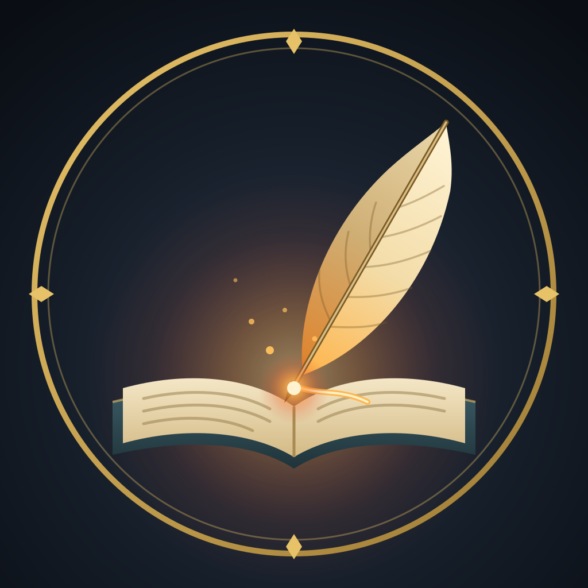

  

<h1 align="center">Ashquill</h1>

<em>An Elder Scrolls companion for your Discord server</em>

  <a href="https://frenchietmh.github.io/ashquill/">Website</a> ·
  <a href="https://frenchietmh.github.io/ashquill/privacy.html">Privacy Policy</a> ·
  <a href="https://frenchietmh.github.io/ashquill/terms.html">Terms of Service</a>

Ashquill brings random lore and NPC quotes from the Unofficial Elder Scrolls Pages (UESP) to your server,
lets your community test itself with trivia, and keeps a leaderboard so everyone can settle who really knows Tamriel best.

## Features

- **Trivia**: questions with a source shown after every round.
- **Guess the quote**: who said it? Then try to name the game it came from.
- **Lore**: a random lore page, or look one up by topic.
- **Your questions**: submit your own trivia and quotes for admin review.

Type `!help` in a server that has Ashquill to see every command (servers can change the `!` prefix).

## Support

Questions, problems or data removal requests: [open an issue](https://github.com/FrenchieTMH/ashquill/issues).

## About this repository

This repository holds Ashquill's website, published with GitHub Pages. The bot's own code is not here.

---

Ashquill is a fan-made project and is not affiliated with or endorsed by Bethesda Softworks or ZeniMax Media.
The Elder Scrolls and related names are trademarks of their respective owners.
